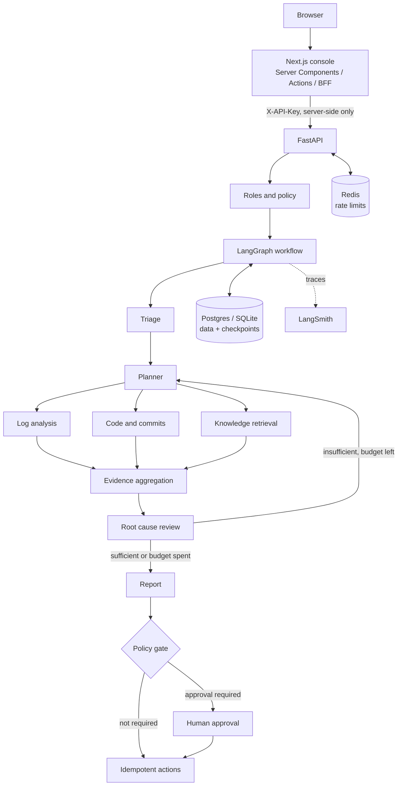

# Atlas AI

**A production-oriented, multi-agent AI platform for autonomous incident investigation, evidence-based root-cause analysis, and controlled remediation.**

> **[Read the Technical Design Document (PDF)](docs/Atlas-AI-Technical-Design.pdf)**: 41 pages covering architecture, the LangGraph workflow, every agent's algorithm and scoring, the tool layer, data model, API, security, reliability, observability, frontend, evaluation, and operations, with diagrams.


## Overview

Atlas AI investigates production incidents with specialized agents, gathers evidence from connected systems, weighs competing hypotheses, and produces an auditable report. Sensitive actions such as opening tickets or rolling back a deployment wait for a human decision.

Submit an incident like:

> Investigate why the latest deployment of checkout-api caused an increase in API errors. Analyze the logs, inspect recent commits, identify the likely root cause, and prepare a remediation plan.

Atlas triages it, queries logs, commits, and runbooks in parallel, reviews the evidence (and loops back for more if it is thin), then reports the root cause with evidence references and pauses for approval before any rollback.

The goal is not a multi-agent chatbot. It is agentic AI engineered for reliability, observability, security, evaluation, and operational control.

## Repository layout

```text
atlas-ai/
├── backend/                 FastAPI + LangGraph service (Python)
│   ├── app/
│   │   ├── api/             routes, request/response schemas, auth dependencies
│   │   ├── agents/          triage, planner, log/code/knowledge agents, review, reporting, actions
│   │   ├── graph/           typed state, nodes, routing edges, workflow, checkpointer
│   │   ├── tools/           tool registry (allowlists, validation, retries) + mock integrations
│   │   ├── services/        incident lifecycle, model gateway
│   │   ├── persistence/     SQLAlchemy models and repository
│   │   ├── security/        roles, action policy, redaction, untrusted-content handling, rate limits
│   │   ├── observability/   logging and LangSmith run metadata
│   │   └── evaluation/      evaluators and evaluation runner
│   ├── data/                mock services, deployments, commits, logs, runbooks
│   ├── datasets/incidents/  versioned evaluation dataset
│   └── tests/               unit, integration, failure_scenarios, evaluation
├── frontend/                Next.js 16 console (TypeScript, Tailwind)
│   └── src/
│       ├── app/             dashboard, investigations, approvals, system pages, BFF route, server actions
│       ├── components/      shell, charts, incident live view, UI primitives
│       └── lib/             server-only API client, types, formatting
├── docs/                    design document (PDF + generator), architecture, threat model, ADRs, evaluation report
├── docker-compose.yml
└── .github/workflows/ci.yml
```

## What is implemented

- **Multi-agent LangGraph workflow** with typed state, parallel fan-out (`Send`), a bounded review-and-replan loop, and a human-approval interrupt.
- **Evidence-driven analysis**: error-rate change and error-signature clustering from logs, risk signals from diffs, BM25 retrieval over runbooks and postmortems, and hypothesis scoring with supporting and contradicting evidence.
- **Deterministic control plane**: planning, routing, authorization, approval policy, and the "sufficient evidence" gate are code. Models only extract, refine, and write; every model output is validated against real evidence IDs and identifiers.
- **Runs offline**: with no model configured, every agent uses its deterministic implementation. Configure any LangChain `init_chat_model` provider to add LLM triage, review, and narrative.
- **Durable execution**: checkpoints after every step (SQLite or Postgres), automatic resumption of interrupted investigations on startup, and approval requests tied to the checkpoint.
- **Fault tolerance**: per-tool timeouts, bounded retries with exponential backoff, transient vs. permanent errors, graceful degradation when an evidence source is down, tool-call and wall-clock budgets, cancellation at node boundaries.
- **Security**: API keys mapped to roles (viewer, operator, approver, admin), per-agent tool allowlists, validated tool arguments, idempotency keys on external actions, optional separation of duties, rate limiting, secret redaction, prompt-injection flagging.
- **Observability**: a workflow event stream per incident (nodes, tool calls, retries, model usage), an audit trail, run metrics, and LangSmith tracing via environment variables.
- **Evaluation**: a dataset, seven evaluators, a runner, and a CI regression gate.
- **Console**: dashboard, live investigation view (pipeline progress, evidence, hypotheses, activity feed), approvals queue, and system page.

## Architecture



More detail: [Technical Design Document (PDF)](docs/Atlas-AI-Technical-Design.pdf) · [docs/architecture.md](docs/architecture.md) · [docs/threat-model.md](docs/threat-model.md) · [docs/decisions/](docs/decisions/)

## API

| Method | Endpoint | Purpose | Permission |
|---|---|---|---|
| `POST` | `/api/v1/incidents` | Submit an investigation (202) | `incident:create` |
| `GET` | `/api/v1/incidents` | List incidents with status counts | `incident:read` |
| `GET` | `/api/v1/incidents/{id}` | Status, metrics, pending approval | `incident:read` |
| `GET` | `/api/v1/incidents/{id}/report` | Report (draft while awaiting approval) | `incident:read` |
| `GET` | `/api/v1/incidents/{id}/events` | Workflow events (`?after=` for polling) | `incident:read` |
| `POST` | `/api/v1/incidents/{id}/approvals` | Approve or reject pending actions | `action:approve` |
| `POST` | `/api/v1/incidents/{id}/cancel` | Cancel an investigation | `incident:cancel` |
| `GET` | `/api/v1/me` | Current principal and permissions | any key |
| `GET` | `/health` | Health, model, checkpointer | none |

Interactive docs at `http://localhost:8000/docs` when the backend is running.

## Local development

### Prerequisites

- Python 3.12+
- Node.js 20+ (24 recommended)
- Optional: Docker, an LLM provider key, a LangSmith key

### Backend

```bash
cd backend
python -m venv .venv
# Windows: .venv\Scripts\activate    macOS/Linux: source .venv/bin/activate
pip install -e ".[dev]"
cp .env.example .env          # optional; defaults run offline with SQLite
uvicorn app.main:app --reload --port 8000
```

With no `API_KEYS` set in development, the key `atlas-dev-key` grants admin (a warning is logged). Production refuses to start without keys.

To use a model, install its integration and set the provider, for example:

```bash
pip install -e ".[anthropic]"
# .env
MODEL_PROVIDER=anthropic
MODEL_NAME=claude-sonnet-5-5
ANTHROPIC_API_KEY=...
```

### Frontend

```bash
cd frontend
npm install
cp .env.example .env.local    # ATLAS_API_URL and ATLAS_API_KEY (server-side only)
npm run dev                   # http://localhost:3000
```

### Everything with Docker

```bash
docker compose up --build     # Postgres, Redis, backend :8000, frontend :3000
```

### Try it

The backend ships with mock integrations covering three scenarios. Use the example buttons on **New investigation**, or:

| Prompt | Expected outcome |
|---|---|
| "Investigate why the latest deployment of checkout-api caused an increase in API errors…" | Root cause: pool size cut in `d-2041`; rollback proposed for approval; a planted prompt injection in the logs is flagged |
| "payments-service is returning 502s on charges since deployment d-3107" | Root cause: `idempotency_key` call change combined with the `stripe-client` 12 upgrade |
| "Login latency spiked for auth-service around 2026-10-12 08:00 UTC" | Probable cause only (Redis dependency); no rollback; open questions listed |

## Testing and evaluation

```bash
cd backend
pytest                          # 42 tests: unit, API/RBAC, failure injection, crash recovery, eval gate
ruff check app tests
python -m app.evaluation.run    # prints the evaluation table
python -m app.evaluation.run --fault logs.search:transient:1   # with injected faults

cd ../frontend
npx tsc --noEmit && npm run lint && npm run build
```

| Metric | What it measures |
|---|---|
| Investigation success rate | Report status is acceptable for the case |
| Root-cause accuracy | Identified hypothesis matches the verified cause |
| Evidence grounding | Every evidence reference in the report resolves |
| Unsupported claim rate | Hypotheses citing no evidence |
| Tool selection accuracy | First-round agents match the expected plan |
| Approval policy compliance | Gated actions never run without approval; rollback proposed only when warranted |
| p50 / p95 latency, tokens | Execution time and model usage |

Results and how to interpret them: [docs/evaluation-report.md](docs/evaluation-report.md). The current dataset is built around the mock scenarios, so perfect offline scores show the pipeline is wired correctly, not that it is accurate on real incidents.

## Roadmap

- [x] FastAPI application and request validation
- [x] LangChain model gateway with structured output and deterministic fallback
- [x] LangGraph workflow with typed state, parallel investigation, and bounded replanning
- [x] Checkpointing (SQLite, Postgres) and resume-on-restart
- [x] Mock log, source control, deployment, knowledge, and ticketing integrations
- [x] Keyword (BM25) runbook retrieval
- [x] Human approval and idempotent action execution
- [x] Roles, tool allowlists, audit records, redaction, rate limiting
- [x] Failure-injection and crash-recovery tests
- [x] Evaluation dataset, evaluators, and CI regression gate
- [x] Next.js console and Docker Compose stack
- [ ] Real integrations (log store, GitHub, deploy system, ticketing)
- [ ] Embedding-based retrieval alongside BM25
- [ ] LangSmith datasets and experiments for model/prompt comparisons
- [ ] OpenTelemetry instrumentation
- [ ] Database migrations (Alembic)
- [ ] Queue-based workers with per-incident locks for multi-replica deployments
- [ ] Evaluation cases from real incidents with verified causes

## Engineering principles

1. **Deterministic control over critical actions.** Authorization and approval belong to explicit policy, never to a model.
2. **Evidence before conclusions.** Reports separate verified facts, hypotheses, and open questions, and cite evidence IDs.
3. **Bounded autonomy.** Every run has tool permissions, call and time budgets, and termination conditions.
4. **Observable by design.** Every node, tool call, retry, and decision is recorded.
5. **Evaluation-driven development.** Changes are measured against a regression dataset.
6. **Complexity justified by evidence.** A dedicated agent exists only where it improves quality, isolation, or maintainability.

## References

- [LangChain](https://docs.langchain.com/oss/python/langchain/overview) · [LangGraph](https://docs.langchain.com/oss/python/langgraph/overview) · [LangSmith](https://docs.langchain.com/langsmith/home)
- [FastAPI](https://fastapi.tiangolo.com/) · [Next.js](https://nextjs.org/docs) · [OpenTelemetry](https://opentelemetry.io/docs/)
