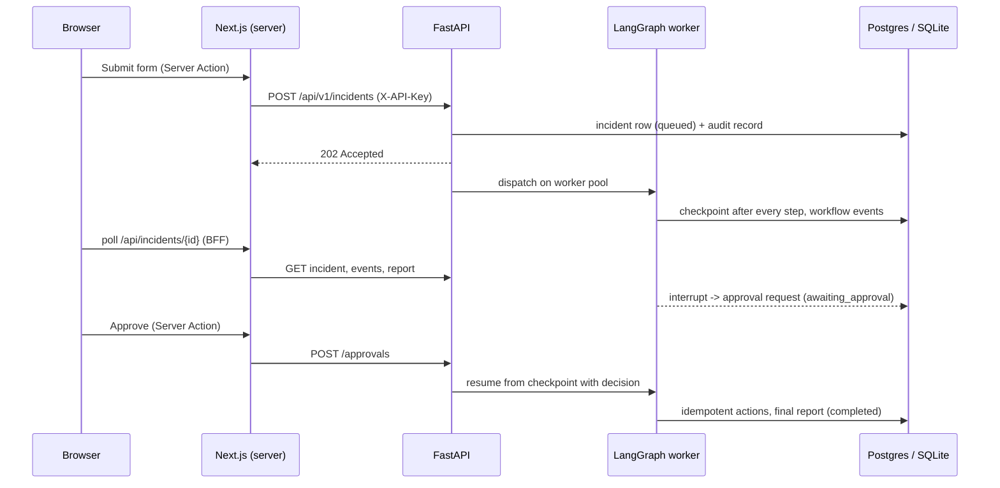
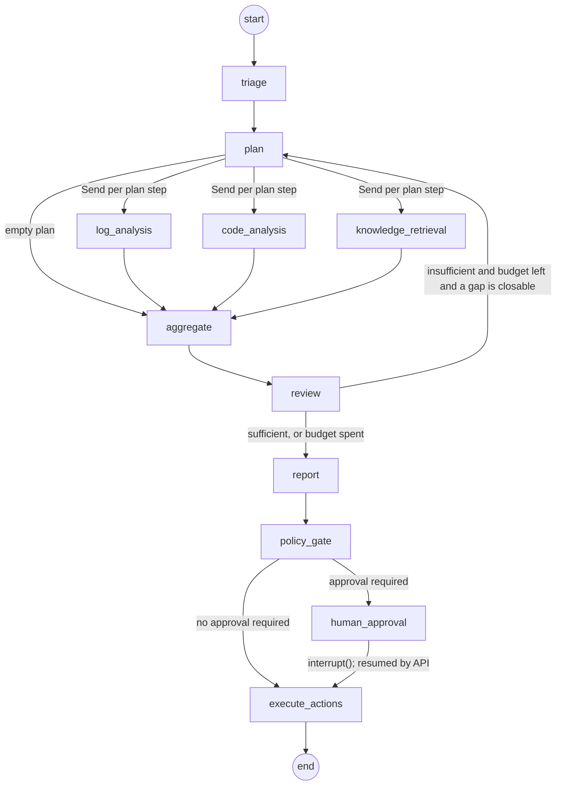

# Architecture

Atlas AI is two deployables in one repository:

| Path | What it is |
|---|---|
| `backend/` | FastAPI service that owns incidents, runs the LangGraph investigation workflow, enforces authorization and approval policy, and records the audit trail. |
| `frontend/` | Next.js (App Router) console. It holds the API key server-side and talks to the backend from Server Components, Server Actions, and one backend-for-frontend route. The browser never calls the backend directly. |

## Request flow

## Workflow graph

- **State** is a typed `IncidentState` (`backend/app/graph/state.py`). Evidence and completed steps use additive reducers so parallel branches merge; everything else has one owning node.
- **Run context** (tool registry, model gateway, event sink, budgets) is injected through LangGraph's runtime context and is never checkpointed.
- **Investigation branches degrade gracefully**: a tool failure marks the step failed and the review sees the gap, instead of the whole workflow failing.
- **Loop bound**: the planner never repeats a completed step and never runs more than one step per agent per round; `MAX_INVESTIGATION_ROUNDS` caps the loop.

## Where models are (and are not) used

| Component | Model use | Deterministic guard |
|---|---|---|
| Triage | Extracts category, symptoms, identifiers | Identifiers resolved against the catalog and deploy system; unknown values dropped |
| Planner | None | - |
| Log / code / knowledge agents | None (statistics, diffs, BM25) | Tool allowlists, argument schemas |
| Root-cause review | Refines hypotheses and confidence | Evidence IDs validated; sufficiency requires 2+ sources and corroboration |
| Reporting | Writes narrative fields | Structure, references, and proposed actions built in code |
| Approval and execution | None | Policy table + human approval + idempotency keys |

Without `MODEL_PROVIDER`/`MODEL_NAME` every agent runs its deterministic implementation, so the full platform (and CI) runs offline.

## Persistence

| Store | Contents |
|---|---|
| Application DB (SQLAlchemy; SQLite or Postgres) | incidents, workflow events, approval requests, audit records |
| Checkpointer (SQLite or Postgres) | LangGraph checkpoints per incident thread |
| Redis (optional) | shared rate-limit counters |

On startup the service resumes any incident left `queued` or `running` from its last checkpoint.

## Known limitations

- Integrations (logs, source control, deploys, ticketing) are mocks over `backend/data/`. Replace the tool implementations, not the agents, to connect real systems.
- Work runs on an in-process thread pool. Multiple API replicas would need a queue and a per-incident lock (Redis) to avoid double execution.
- Schema is created with `create_all`; there are no migrations yet.
- The Postgres checkpointer and Redis limiter code paths are not covered by the automated tests (they need running services).
